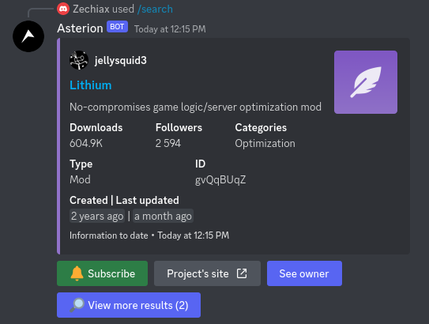
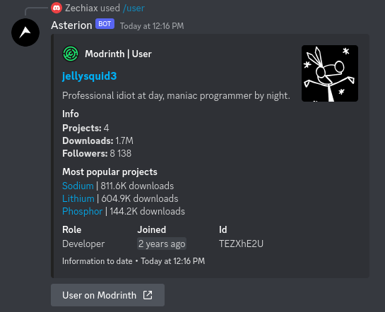
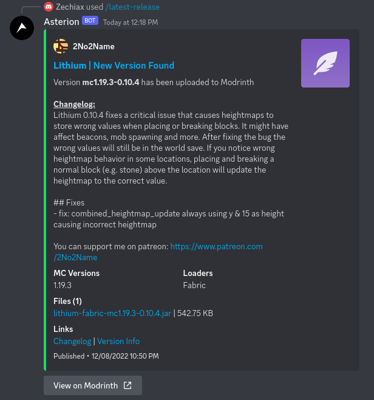

<div align="center">

# Asterion


Access all of [Modrinth](https://modrinth.com/) within Discord

**[Invite](https://discord.com/api/oauth2/authorize?client_id=986993814671614094&permissions=537316416&scope=bot%20applications.commands)** · **[Documentation](https://zechiax.github.io/Asterion/)**

</div>

## Features
- Search for Modrinth projects
- Find user on Modrinth
- Auto embed when message contains URL to a Modrinth project (opt-in feature)
- Subscribe for project updates and send them to custom channel
- Follow Modrinth users with `/follow user` and get updates for all of their projects, including new ones
    - Get a message when a followed user publishes a new project, with its own ping role
    - Ignore single projects of a followed user, filter by release type and loader
- Manage everything from one place with `/manage`: subscribed projects, followed users and the server settings
  (manage role, ping role, language, look of the update messages)

## Images
- Some things shown in these pictures can be changed using the `/manage` command (f.e. the subscribe button can be hidden from search embeds)

<div align="center">

### Search


### User


### Latest release


</div>

## Self-hosting (Docker)
Images for `linux/amd64` and `linux/arm64` are published to `ghcr.io/zechiax/asterion`:
- `latest` - the newest release, `4` / `4.0` / `4.0.0` - pinned releases
- `next` - the current `main` branch

Everything the bot stores (`config.toml`, `data.sqlite`, `logs/`) lives in `./data` next to `compose.yml`.

```bash
cp .env.example .env      # fill in ASTERION_TOKEN (and PUID/PGID if not 1000)
docker compose up -d
```

Any value from `config.toml` can also be set as an environment variable with the `ASTERION_` prefix, e.g. `ASTERION_TOKEN`.

## Bug reports / Feature suggestions
- If something's not working and the bot is online, check [Modrinth's status page](https://status.modrinth.com/) as Modrinth can be offline
- For bug reports and feature suggestions start a [new issue](https://github.com/Zechiax/RinthBot/issues/new)

## Data stored
- This bot needs to store some data so it can provide you with the updates
- Data stored are
    - Guild ID
    - Date the bot joined your guild
    - IDs of channels where you want to send updates
    - List of subscribed projects
        - And the date you subscribed to them
    - List of followed Modrinth users (their public Modrinth ID and username)
        - And the date you followed them, the projects known for each follow and the ignored ones
    - Bot preferences
- This data is stored in a database and is not shared with anyone else
- You can delete all data stored by the bot when you kick the bot from your guild
